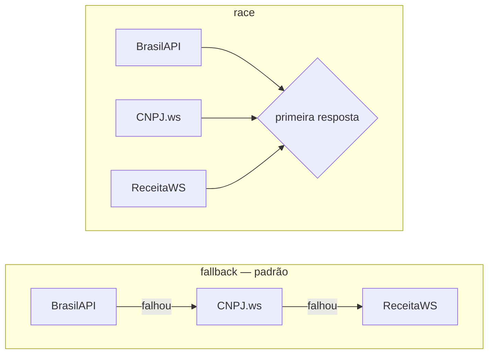

# cnpj-hub

[](https://github.com/Guilhermeksk/cnpj-hub/actions/workflows/ci.yml)
[](https://www.npmjs.com/package/cnpj-hub)


[](LICENSE)

**Consulta de CNPJ resiliente para Node.js.** Uma única API que fala com vários provedores
públicos (BrasilAPI, CNPJ.ws e ReceitaWS), troca de provedor automaticamente quando um falha,
tenta de novo com backoff, guarda em cache e devolve **sempre o mesmo formato de dados**.
Vem com biblioteca, CLI e servidor HTTP.

```bash
npx cnpj-hub 00.000.000/0001-91
```

```text
BANCO DO BRASIL SA
  CNPJ           00.000.000/0001-91 (MATRIZ)
  Nome fantasia  DIRECAO GERAL
  Situação       ATIVA
  Abertura       1966-08-01
  Atividade      6422100 — Bancos múltiplos, com carteira comercial
  Endereço       QUADRA SAUN QUADRA 5 BLOCO B TORRE I, II, III, SN — ASA NORTE — BRASILIA/DF
  Fonte          brasilapi
```

---

## Por que existe

Quem precisa enriquecer cadastros, validar fornecedores ou qualificar leads normalmente
esbarra em três problemas com as APIs gratuitas de CNPJ:
1. **Instabilidade e limites** — algumas aceitam só 3 requisições por minuto e ficam fora do ar
   sem aviso.
2. **Formatos diferentes** — cada uma devolve campos, datas, telefones e códigos CNAE de um jeito.
3. **Dados desatualizados** — bases montadas a partir dos dados abertos da Receita podem não ter
   empresas abertas há poucos dias.

O `cnpj-hub` resolve isso com padrões de resiliência (fallback, retry, timeout, cache) e uma
camada de normalização com tipos TypeScript.

## Recursos

- 🔁 **Fallback automático** entre provedores, na ordem que você escolher
- 🏁 **Modo `race`**: consulta todos ao mesmo tempo, usa a primeira resposta e **cancela** o resto
- ♻️ **Retry com backoff exponencial + jitter**, respeitando o cabeçalho `Retry-After`
- ⏱️ **Timeout por tentativa** e cancelamento com `AbortSignal`
- 🧠 **Cache LRU com TTL** em memória, plugável (Redis, Memcached...)
- 🔀 **Deduplicação**: consultas simultâneas ao mesmo CNPJ geram uma única requisição
- 🧾 **Dados normalizados** (`Company`) independentemente do provedor
- 🔤 **CNPJ alfanumérico** (novo formato da Receita Federal a partir de julho/2026)
- 📦 **Lote com concorrência limitada**, exportando para CSV, JSON ou JSON Lines
- 🌐 **API HTTP** sem dependências + imagem **Docker**
- 📈 **Hook de observabilidade** (`onEvent`) para logs e métricas
- ✅ **Zero dependências de runtime**, 100 testes, CI em Linux e Windows

## Instalação

```bash
npm install cnpj-hub
```

Requer Node.js 22 ou superior.

## Uso como biblioteca

```ts
import { CnpjHub } from 'cnpj-hub';

const hub = new CnpjHub();

const empresa = await hub.lookup('11.222.333/0001-81');
console.log(empresa.legalName, empresa.status, empresa.address.city);
```

Atalho para uso rápido (usa uma instância compartilhada com as opções padrão):

```ts
import { lookup } from 'cnpj-hub';

const empresa = await lookup('11222333000181');
```

### Validação e formatação (sem rede)

```ts
import { format, generate, isValid } from 'cnpj-hub';

isValid('11.222.333/0001-81'); // true
isValid('12.ABC.345/01DE-35'); // true — formato alfanumérico
format('11222333000181'); // '11.222.333/0001-81'
generate({ alphanumeric: true, formatted: true }); // CNPJ aleatório válido, útil para testes
```

### Consulta em lote

```ts
const resultados = await hub.lookupMany(listaDeCnpjs, { concurrency: 3 });

for (const r of resultados) {
  if (r.ok) console.log(r.company.legalName);
  else console.warn(r.input, r.error.message);
}
```

`lookupMany` nunca rejeita: cada item informa se deu certo, e a ordem de entrada é preservada.

## Estratégias



| Estratégia | Como funciona                                                          | Quando usar                                    |
| ---------- | ---------------------------------------------------------------------- | ---------------------------------------------- |
| `fallback` | Um provedor por vez, na ordem configurada                              | Lotes grandes; economiza limites de requisição |
| `race`     | Todos em paralelo; o primeiro sucesso vence e os demais são cancelados | Requisições interativas onde latência importa  |

Em cada provedor, falhas **temporárias** (timeout, erro de rede, HTTP 429 e 5xx) são repetidas
com backoff exponencial. Se o provedor pedir uma pausa maior que `maxRetryDelayMs`
(via `Retry-After`), o cliente pula direto para o próximo provedor em vez de ficar esperando.

Um "não encontrado" **não** encerra a busca: os provedores têm bases com atualizações
diferentes, então os outros ainda são consultados. Só quando **todos** dizem que o CNPJ não
existe é lançado `CnpjNotFoundError`.

## Configuração

```ts
const hub = new CnpjHub({
  providers: ['brasilapi', 'cnpjws', 'receitaws'],
  strategy: 'fallback',
  timeoutMs: 10_000,
  retries: 1,
  retryDelayMs: 500,
  maxRetryDelayMs: 5_000,
  cacheTtlMs: 24 * 60 * 60 * 1000,
  onEvent: (e) => console.debug(e),
});
```

| Opção             | Padrão                                 | Descrição                                                           |
| ----------------- | -------------------------------------- | ------------------------------------------------------------------- |
| `providers`       | `['brasilapi', 'cnpjws', 'receitaws']` | Nomes dos provedores embutidos ou objetos `Provider` próprios       |
| `strategy`        | `'fallback'`                           | `'fallback'` ou `'race'`                                            |
| `timeoutMs`       | `10000`                                | Tempo limite de cada tentativa                                      |
| `retries`         | `1`                                    | Novas tentativas por provedor em falhas temporárias                 |
| `retryDelayMs`    | `500`                                  | Base do backoff exponencial                                         |
| `maxRetryDelayMs` | `5000`                                 | Maior espera aceitável antes de tentar de novo                      |
| `cache`           | `MemoryCache` (1000 itens)             | Qualquer objeto com `get`/`set`, ou `false` para desligar           |
| `cacheTtlMs`      | 24 h                                   | Validade do cache                                                   |
| `fetch`           | `globalThis.fetch`                     | Implementação de `fetch` (proxy, testes)                            |
| `onEvent`         | —                                      | Recebe `attempt`, `success`, `failure`, `cache-hit` e `cache-error` |

Provedores com plano pago aceitam token:

```ts
import { CnpjHub, cnpjWs, receitaWs } from 'cnpj-hub';

const hub = new CnpjHub({
  providers: [receitaWs({ token: process.env.RECEITAWS_TOKEN }), cnpjWs(), 'brasilapi'],
});
```

## Dados retornados

Todos os provedores são convertidos para o mesmo formato:

```jsonc
{
  "cnpj": "00000000000191",
  "legalName": "BANCO DO BRASIL SA",
  "tradeName": "DIRECAO GERAL",
  "status": "ATIVA",
  "branchType": "MATRIZ",
  "openedAt": "1966-08-01",
  "legalNature": "Sociedade de Economia Mista",
  "size": "DEMAIS",
  "shareCapital": 120000000000,
  "mainActivity": { "code": "6422100", "description": "Bancos múltiplos, com carteira comercial" },
  "secondaryActivities": [
    { "code": "6499999", "description": "Outras atividades de serviços financeiros..." }
  ],
  "address": {
    "street": "QUADRA SAUN QUADRA 5 BLOCO B TORRE I, II, III",
    "number": "SN",
    "complement": "ANDAR T I SL S101 A S1602 ...",
    "district": "ASA NORTE",
    "zipCode": "70040912",
    "city": "BRASILIA",
    "state": "DF"
  },
  "phones": ["6134939002"],
  "email": "secex@bb.com.br",
  "simples": false,
  "mei": false,
  "partners": [{ "name": "...", "role": "Diretor", "since": "2023-05-17" }],
  "source": "brasilapi",
  "fetchedAt": "2026-10-21T18:00:00.000Z"
}
```

Regras de normalização: datas em ISO (`YYYY-MM-DD`), CEP/telefones/CNAE só com dígitos,
textos vazios viram `null`, situação/porte em maiúsculas e e-mail em minúsculas.

## Erros

| Erro                      | Quando                                                                                          |
| ------------------------- | ----------------------------------------------------------------------------------------------- |
| `InvalidCnpjError`        | Entrada com tamanho, caracteres ou dígitos verificadores inválidos (nenhuma requisição é feita) |
| `CnpjNotFoundError`       | Todos os provedores dizem que o CNPJ não existe                                                 |
| `AllProvidersFailedError` | Nenhum provedor conseguiu responder; `error.errors` lista a falha de cada um                    |
| `ProviderError`           | Falha de um provedor específico (aparece dentro do erro acima)                                  |

Todos herdam de `CnpjHubError`.

## Extensível

### Cache externo (ex.: Redis)

```ts
import { CnpjHub, type Cache, type Company } from 'cnpj-hub';

const redisCache: Cache<Company> = {
  get: async (cnpj) => {
    const raw = await redis.get(`cnpj:${cnpj}`);
    return raw ? JSON.parse(raw) : undefined;
  },
  set: async (cnpj, empresa, ttlMs) => {
    await redis.set(`cnpj:${cnpj}`, JSON.stringify(empresa), 'PX', ttlMs);
  },
};

const hub = new CnpjHub({ cache: redisCache });
```

Falhas do cache **não** derrubam a consulta: elas são reportadas via `onEvent` (`cache-error`)
e a busca segue nos provedores.

### Provedor próprio

```ts
import { CnpjNotFoundError, type Provider } from 'cnpj-hub';

const bancoInterno: Provider = {
  name: 'banco-interno',
  async lookup(cnpj, { signal }) {
    const empresa = await db.empresas.findByCnpj(cnpj, { signal });
    if (!empresa) throw new CnpjNotFoundError(cnpj, 'banco-interno');
    return empresa;
  },
};

const hub = new CnpjHub({ providers: [bancoInterno, 'brasilapi', 'cnpjws'] });
```

Veja mais em [`examples/`](examples).

## CNPJ alfanumérico

A partir de julho de 2026 a Receita Federal passou a emitir CNPJs com letras nas 12 primeiras
posições (IN RFB nº 2.229/2024). O cálculo do dígito verificador continua sendo módulo 11, mas
cada caractere vale `código ASCII − 48` (`0`–`9` → 0–9, `A` → 17, `B` → 18...). Validação,
formatação e geração já suportam os dois formatos:

```ts
isValid('12.ABC.345/01DE-35'); // true
```

## CLI

```bash
npm install -g cnpj-hub   # ou use npx cnpj-hub
```

```bash
cnpj-hub 00.000.000/0001-91                 # consulta com saída formatada
cnpj-hub 00000000000191 --json              # saída JSON
cnpj-hub validate 11.222.333/0001-81        # valida sem acessar a rede
cnpj-hub format 11222333000181              # 11.222.333/0001-81
cnpj-hub generate -n 5 --alpha              # gera CNPJs válidos para testes
cnpj-hub 11222333000181 --strategy race -v  # mostra cada tentativa no stderr
```

### Lote → planilha

Lê um CNPJ por linha (ou separados por vírgula/ponto e vírgula; `#` inicia comentário) de um
arquivo ou da entrada padrão:

```bash
cnpj-hub batch leads.txt -o csv > empresas.csv
cat cnpjs.txt | cnpj-hub batch -c 2 > empresas.jsonl
```

O CSV tem uma linha por entrada (inclusive as que falharam, com a coluna `erro` preenchida),
então dá para abrir direto no Excel/Google Sheets.

## API HTTP

```bash
cnpj-hub serve --port 3000
```

| Rota                       | Resposta                                                                           |
| -------------------------- | ---------------------------------------------------------------------------------- |
| `GET /cnpj/:cnpj`          | `200` empresa · `400` inválido · `404` não existe · `502` provedores indisponíveis |
| `GET /cnpj/:cnpj/validate` | Validação local, sem rede                                                          |
| `GET /health`              | `{ "status": "ok" }`                                                               |

```bash
curl localhost:3000/cnpj/11222333000181
```

Também dá para embutir o servidor na sua aplicação:

```ts
import { CnpjHub, createServer } from 'cnpj-hub';

createServer({ hub: new CnpjHub({ strategy: 'race' }) }).listen(3000);
```

### Docker

```bash
docker build -t cnpj-hub .
docker run -p 3000:3000 cnpj-hub
```

## Arquitetura

```text
src/
├── cnpj.ts            validação, formatação e geração (numérico + alfanumérico)
├── client.ts          CnpjHub: fallback/race, retry, timeout, cache, deduplicação
├── cache.ts           interface Cache + MemoryCache (LRU com TTL)
├── errors.ts          hierarquia de erros
├── types.ts           Company, Provider e afins
├── providers/
│   ├── http.ts        GET JSON + mapeamento de status HTTP para erros
│   ├── normalize.ts   funções puras de normalização
│   ├── brasilapi.ts
│   ├── cnpjws.ts
│   └── receitaws.ts
├── server.ts          API HTTP com node:http
└── cli/               parsing de argumentos, saída formatada e CSV
```

Decisões de projeto:
- **Sem dependências de runtime**: só APIs nativas do Node (`fetch`, `AbortSignal`,
  `node:http`, `node:util.parseArgs`, `node:test`). Menos superfície de ataque e instalação instantânea.
- **Provedores são objetos simples** (`{ name, lookup }`), então qualquer fonte de dados entra
  no fallback sem herança nem registro global.
- **O timeout é garantido pelo cliente**, não pelo provedor: mesmo um provedor customizado que
  ignore o `AbortSignal` é interrompido.
- **Testes não acessam a internet**: o `fetch` é injetado, e os payloads de exemplo seguem o
  formato real de cada API.

## Desenvolvimento

```bash
npm install
npm test            # 100 testes com node:test
npm run coverage    # relatório de cobertura
npm run lint        # Biome
npm run typecheck
npm run build
```

Veja o [guia de contribuição](CONTRIBUTING.md).

## Aviso

Este projeto não tem relação com a Receita Federal nem com os provedores consultados. Respeite os
termos de uso e os limites de cada serviço. Os dados são públicos, mas incluem nomes de sócios:
trate-os de acordo com a LGPD.

## Licença

[MIT](LICENSE)
